# Clue images — WHAT IS THE KEYWORD? (Checkpoint C2)

All 24 clue images are local (`server/media/clues/qNN-MM.webp`). Since Checkpoint M1 they are server-side only (not shipped to clients) and will be released scene by scene by the server in M2. Filenames are neutral and never contain answers. The in-game **Nguồn hình ảnh** dialog (final screen only, so it cannot spoil a round) lists the same sources.

**Use:** educational classroom activity only. Keep the images inside this local project; do not upload or redistribute the collection. Press and agency photos (VnExpress, Ngôi Sao, TTXVN, commune portal) are used with credit for local teaching, not under an open licence. Watermarks are kept.

**Contact sheet:** [clue-contact-sheet.jpg](clue-contact-sheet.jpg) · **Data:** [clue-assets.json](clue-assets.json)

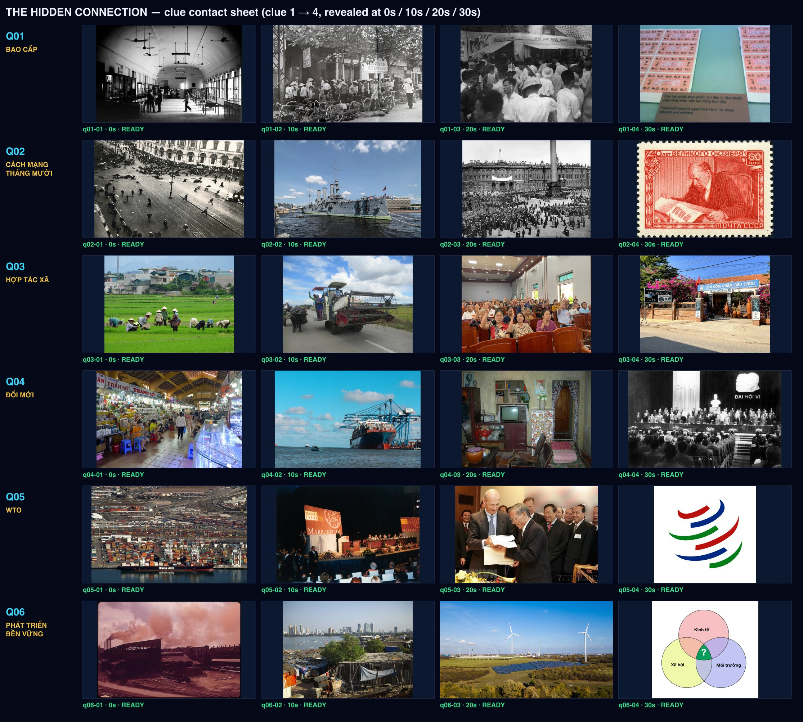

## Video clips

The Question 4 prototype clip `server/media/clips/c01.mp4` is a CC BY-SA 4.0 adaptation of q04-01
(Bahnfrend) and q04-02 (Nathan.cima). Sources, modifications and the exact FFmpeg command:
[media-clips.md](media-clips.md).

## Status

| Slot | Status | Change in C2 | Source |
|---|---|---|---|
| q01-01 | READY | replaced | Philip Jones Griffiths (Magnum) — VnExpress "Buôn bán thời mậu dịch"; also Saigoneer |
| q01-02 | READY | replaced | John Ramsden — VnExpress "Buôn bán thời mậu dịch" |
| q01-03 | READY | replaced | Ảnh tư liệu (photographer not credited) — Ngôi Sao (VnExpress) "Những bức ảnh hiếm về cửa hàng mậu dịch thời bao cấp" |
| q01-04 | READY | retained | Myra Siason — Wikimedia Commons |
| q02-01 | READY | retained | Viktor Bulla — Wikimedia Commons |
| q02-02 | READY | retained | Florstein (WikiPhoto.Space) — Wikimedia Commons |
| q02-03 | READY | retained | Karl Bulla / Finnish Heritage Agency — Wikimedia Commons |
| q02-04 | READY | retained | Post of the USSR (after a photo by P. Otsup) — Wikimedia Commons |
| q03-01 | READY | retained | Adam Jones — Wikimedia Commons |
| q03-02 | READY | retained | CNEcija12345 — Wikimedia Commons |
| q03-03 | READY | replaced | Phạm Thị Xuân – Đài Truyền thanh xã Lê Lợi — Cổng thông tin điện tử xã Lê Lợi, tỉnh Hưng Yên |
| q03-04 | READY | retained | Windrain — Wikimedia Commons |
| q04-01 | READY | retained | Bahnfrend — Wikimedia Commons |
| q04-02 | READY | retained | Nathan.cima — Wikimedia Commons |
| q04-03 | READY | retained | Rungbachduong — Wikimedia Commons |
| q04-04 | READY | replaced | TTXVN (ảnh tư liệu) — TTXVN – Nhân vật & Sự kiện "Đại hội Đảng lần thứ VI (15-18/12/1986)" |
| q05-01 | READY | retained | Daniel Parks — Wikimedia Commons |
| q05-02 | READY | replaced | © WTO — WTO Flickr, via Wikimedia Commons |
| q05-03 | READY | replaced | TTXVN — Tạp chí Công Thương "Chuyện đàm phán gia nhập WTO" |
| q05-04 | READY | retained | World Trade Organization — Wikimedia Commons |
| q06-01 | READY | retained | LeRoy Woodson / US EPA DOCUMERICA — Wikimedia Commons |
| q06-02 | READY | retained | Rudolph A. Furtado — Wikimedia Commons |
| q06-03 | READY | retained | Sebastian Koppehel — Wikimedia Commons |
| q06-04 | READY | retained | Nicoguaro (modified) — Wikimedia Commons |

## Sequence review

- **Q01 BAO CẤP:** Sparse state store (hard) → queue for vegetables → "MẬU DỊCH QUỐC DOANH" storefront → tem phiếu (near-giveaway).
- **Q02 CÁCH MẠNG THÁNG MƯỜI:** 1917 street unrest → cruiser Aurora → Winter Palace with crowds → Lenin stamp "40 years of Great October".
- **Q03 HỢP TÁC XÃ:** Farmers working together → shared harvester → members voting by show of hands → "HTX" signboard.
- **Q04 ĐỔI MỚI:** Lively private market → export port → subsidy-era home (the "before") → Đại hội VI, 12/1986.
- **Q05 WTO:** Container port → Uruguay Round, Marrakech 1994 → Vietnam's accession signing, 7/11/2006 → WTO emblem.
- **Q06 PHÁT TRIỂN BỀN VỮNG:** Industrial pollution → slum beside skyline → wind + solar on restored land → Kinh tế / Xã hội / Môi trường with "?".

Each clue adds information; none shows the answer text before clue 4 (q01-04 label "phiếu thực phẩm", q02-04 "Великого Октября", q03-04 "HTX", q04-04 "ĐẠI HỘI VI" and q05-04 emblem are intentional final hints).

## Accuracy notes to keep in mind when presenting

- **q01-03** is undated and uncredited, probably late 1950s–1960s (northern Vietnam), earlier than 1976–1986.
- **q02-01** is the July Days (July 1917) and **q02-03** is May Day 1917 — neither is the October uprising itself; present them as "1917", not "October".
- **q04-03** is a 2006 museum reconstruction, not a 1980s photo.
- **q05-03** shows 7/11/2006 (approval and protocol signing in Geneva); Vietnam became the 150th member on 11/1/2007. Its backdrop was blurred to hide the WTO emblem.
- **q01-01, q03-02, q05-01, q06-01..03** are not from Vietnam; they are conceptual illustrations.

## Q01 — BAO CẤP

### q01-01 · clue 1 (0 s) · replaced
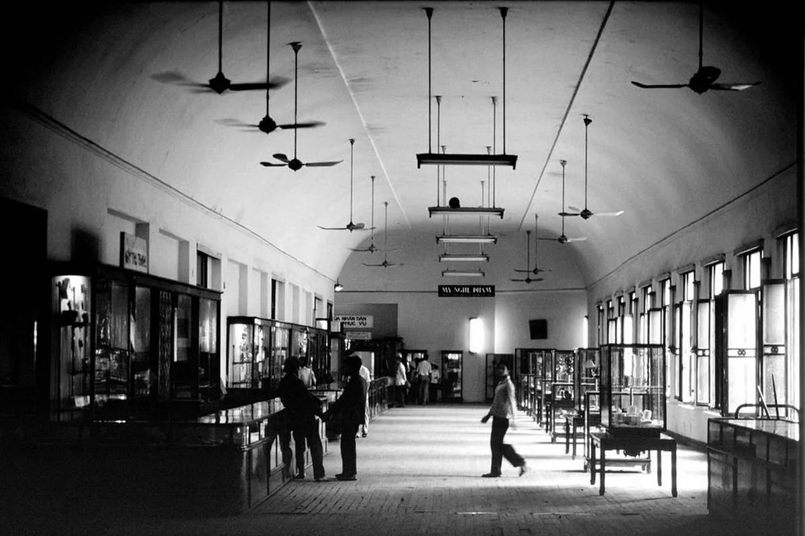

- **Shows:** Black-and-white interior of a long state department store hall in central Hanoi; glass display cases mostly empty, a few shoppers.
- **Source:** Philip Jones Griffiths (Magnum) — VnExpress "Buôn bán thời mậu dịch"; also Saigoneer — https://vnexpress.net/buon-ban-thoi-mau-dich-3511043.html
- **Context:** Captioned "Bên trong cửa hàng bách hóa trung tâm ở Hà Nội". Saigoneer dates the Griffiths set to 1980, VnExpress to 1985; both are inside the subsidy period.
- **Concerns:** Exact year uncertain (1980 or 1985). Source is 1200 px wide.
- **Usage:** Magnum copyright; used for local classroom teaching with credit.
- **File:** `server/media/clues/q01-01.webp` (1200×800, 86 KB)

### q01-02 · clue 2 (10 s) · replaced
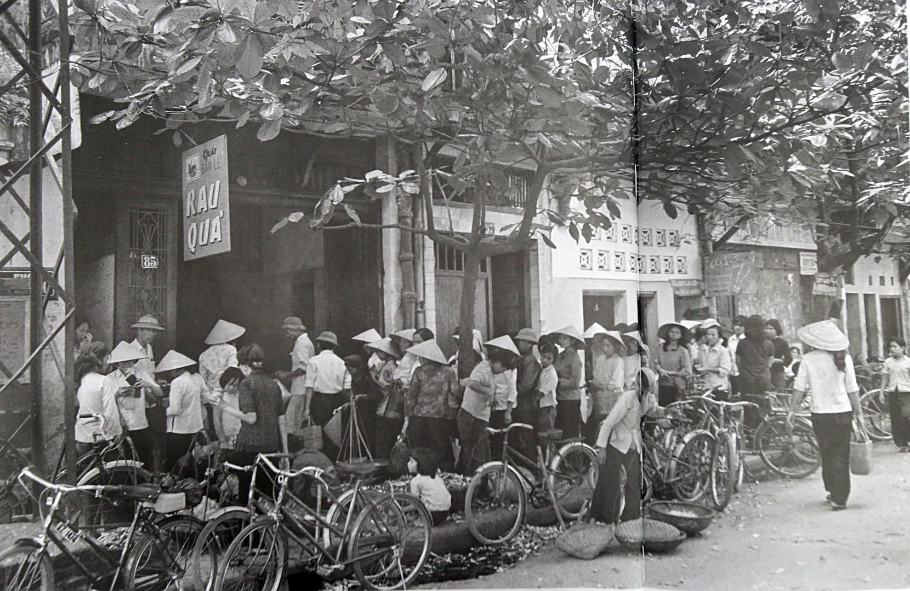

- **Shows:** Long queue of people in nón lá and pith helmets outside shop no. 85 signed "QUẦY BÁN LẺ RAU QUẢ", bicycles in front.
- **Source:** John Ramsden — VnExpress "Buôn bán thời mậu dịch" — https://vnexpress.net/buon-ban-thoi-mau-dich-3511043.html
- **Context:** Caption: "Xếp hàng mua rau, củ, quả – loại thực phẩm không cần đến tem phiếu." Ramsden was British deputy ambassador in Hanoi 1980–1983; published in the book "Hà Nội một thời".
- **Concerns:** Scan of a book spread: faint vertical gutter line at about 70% width.
- **Usage:** Photographer copyright; local classroom use with credit.
- **File:** `server/media/clues/q01-02.webp` (1660×1080, 290 KB)

### q01-03 · clue 3 (20 s) · replaced
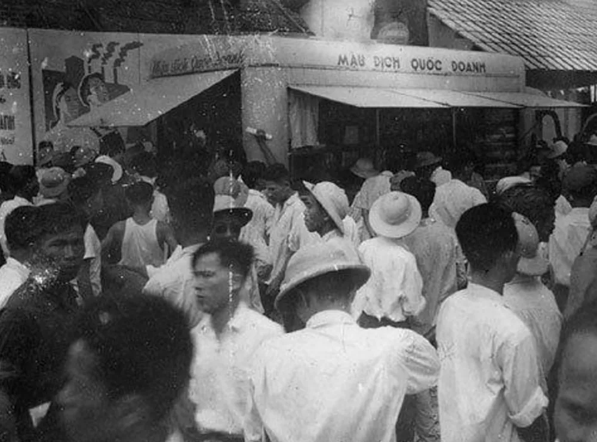

- **Shows:** Crowd in front of a shop whose signboard reads "MẬU DỊCH QUỐC DOANH".
- **Source:** Ảnh tư liệu (photographer not credited) — Ngôi Sao (VnExpress) "Những bức ảnh hiếm về cửa hàng mậu dịch thời bao cấp" — https://ngoisao.vnexpress.net/nhung-buc-anh-hiem-ve-cua-hang-mau-dich-thoi-bao-cap-3498655.html
- **Context:** Caption: "Một cửa hàng mậu dịch quốc doanh." Clothing suggests northern Vietnam, probably late 1950s–1960s, when the state-trading (mậu dịch quốc doanh) system was established in the North — an earlier phase of the same subsidy mechanism.
- **Concerns:** No photographer, place or year; grainy print, 1000 px wide (likely upscaled by the publisher). Predates 1976–1986.
- **Usage:** Archive photo via press; local classroom use with credit.
- **File:** `server/media/clues/q01-03.webp` (1000×740, 70 KB)

### q01-04 · clue 4 (30 s) · retained
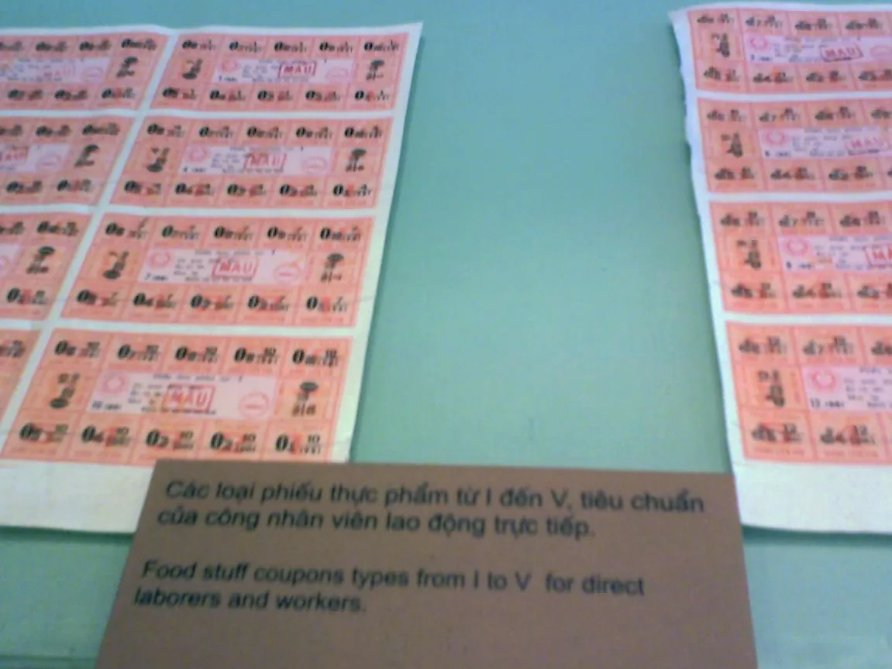

- **Shows:** Sheets of Vietnamese food ration coupons (tem phiếu) stamped "MẪU" in a museum case with a bilingual label.
- **Source:** Myra Siason — Wikimedia Commons — https://commons.wikimedia.org/wiki/File:Tem_phi%E1%BA%BFu_th%E1%BB%9Di_bao_c%E1%BA%A5p.jpg
- **Context:** Authentic coupons displayed in a Hanoi museum (2007 photo).
- **Concerns:** Slightly soft (1151 px source). Label "phiếu thực phẩm" is a strong hint — intended for clue 4.
- **Usage:** CC BY-SA 2.0 — credit required.
- **File:** `server/media/clues/q01-04.webp` (1151×864, 55 KB)

## Q02 — CÁCH MẠNG THÁNG MƯỜI

### q02-01 · clue 1 (0 s) · retained
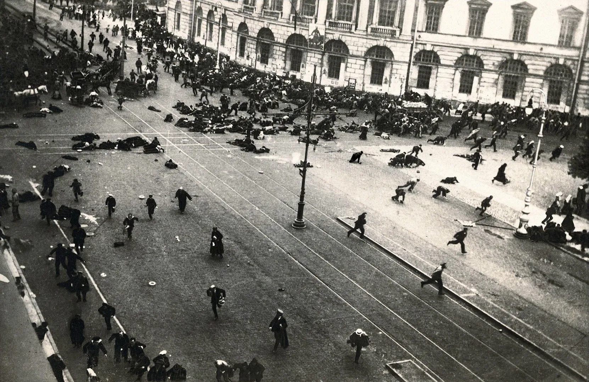

- **Shows:** Overhead view of Nevsky Prospekt, Petrograd: crowds scatter and lie flat as troops open fire.
- **Source:** Viktor Bulla — Wikimedia Commons — https://commons.wikimedia.org/wiki/File:19170704_Riot_on_Nevsky_prosp_Petrograd.jpg
- **Context:** July Days, 4 (17) July 1917 — between the February and October revolutions. Shows 1917 revolutionary unrest, not the October uprising itself.
- **Concerns:** Do not caption as October or February.
- **Usage:** Public domain.
- **File:** `server/media/clues/q02-01.webp` (1662×1080, 385 KB)

### q02-02 · clue 2 (10 s) · retained
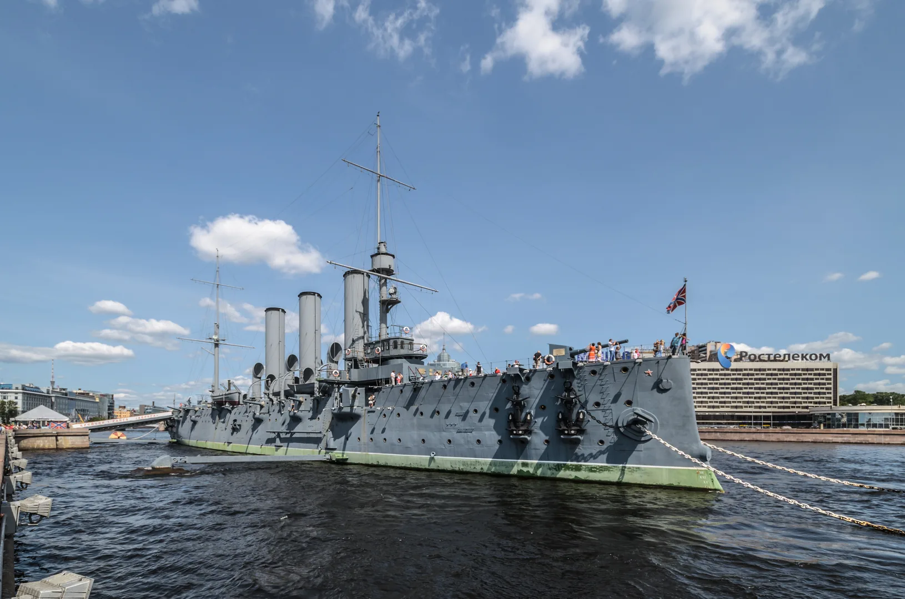

- **Shows:** Cruiser Aurora moored on the Neva, Saint Petersburg (2013).
- **Source:** Florstein (WikiPhoto.Space) — Wikimedia Commons — https://commons.wikimedia.org/wiki/File:Cruiser_Aurora_01.jpg
- **Context:** The preserved ship whose blank shot signalled the assault on the Winter Palace (25 Oct / 7 Nov 1917).
- **Concerns:** Modern photo of the historical ship.
- **Usage:** CC BY-SA 4.0 — credit required.
- **File:** `server/media/clues/q02-02.webp` (1630×1080, 157 KB)

### q02-03 · clue 3 (20 s) · retained
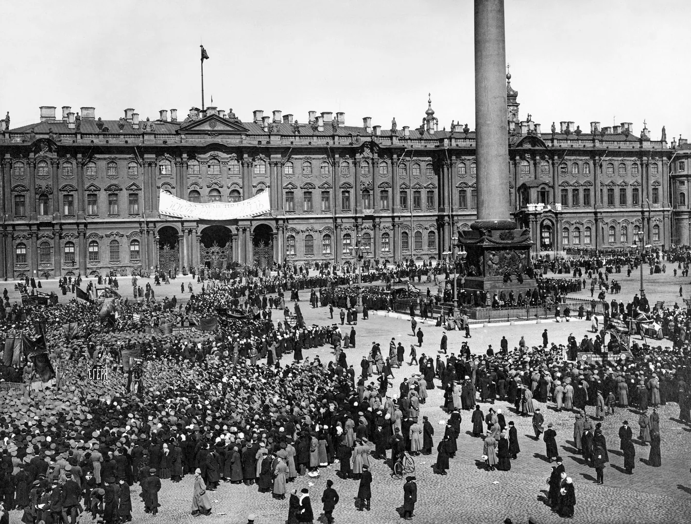

- **Shows:** Winter Palace and Alexander Column with Palace Square full of demonstrators and banners.
- **Source:** Karl Bulla / Finnish Heritage Agency — Wikimedia Commons — https://commons.wikimedia.org/wiki/File:First_of_May_demonstration_in_Petrograd_1917_(JOKAOT4SK1917_21-5).tif
- **Context:** May Day demonstration, Petrograd, 1 May 1917 (archive caption).
- **Concerns:** Shows the Winter Palace in 1917, but NOT the October storming — do not describe it as such.
- **Usage:** CC BY 4.0; also public domain by age.
- **File:** `server/media/clues/q02-03.webp` (1422×1080, 388 KB)

### q02-04 · clue 4 (30 s) · retained
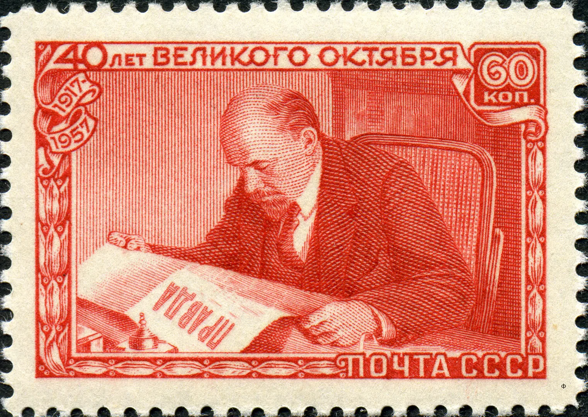

- **Shows:** 1957 Soviet stamp: Lenin reading Pravda, "1917–1957", "40 ЛЕТ ВЕЛИКОГО ОКТЯБРЯ".
- **Source:** Post of the USSR (after a photo by P. Otsup) — Wikimedia Commons — https://commons.wikimedia.org/wiki/File:Stamp_of_USSR_2064.jpg
- **Context:** 40th anniversary of the October Revolution stamp.
- **Concerns:** Russian "Великого Октября" (Great October) — strong hint, intended for clue 4. Shows "1917", not the exact date 7/11.
- **Usage:** Public domain (Soviet stamps).
- **File:** `server/media/clues/q02-04.webp` (1522×1080, 447 KB)

## Q03 — HỢP TÁC XÃ

### q03-01 · clue 1 (0 s) · retained
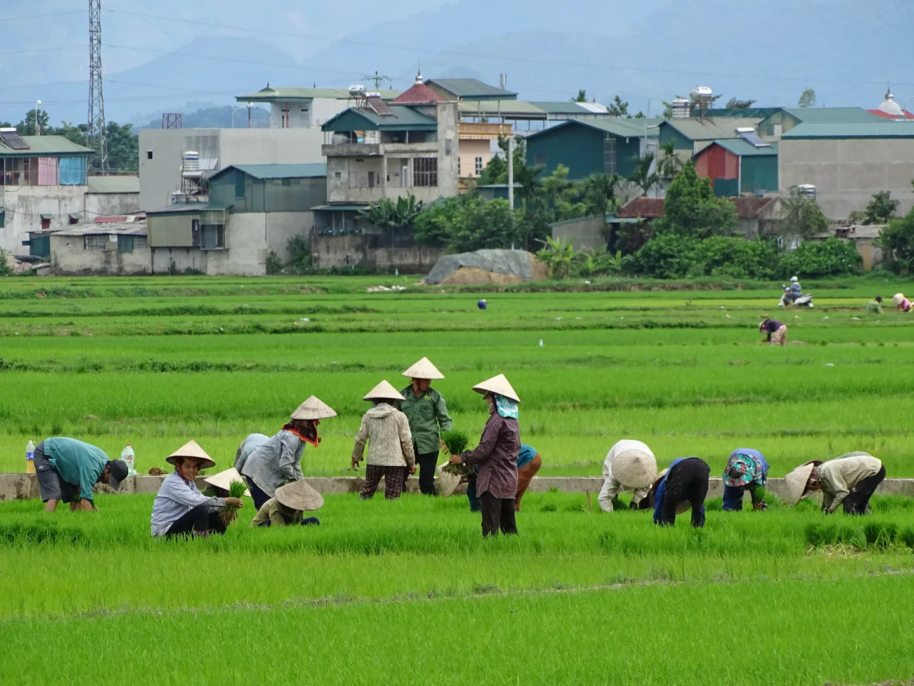

- **Shows:** About a dozen farmers in nón lá transplanting rice together, Điện Biên Phủ.
- **Source:** Adam Jones — Wikimedia Commons — https://commons.wikimedia.org/wiki/File:Workers_Planting_Rice_Seedlings_-_Dien_Bien_Phu_-_Vietnam_-_01_(48159228487).jpg
- **Context:** Vietnam, 2019.
- **Concerns:** Generic on its own (intended for clue 1).
- **Usage:** CC BY-SA 2.0 — credit required.
- **File:** `server/media/clues/q03-01.webp` (1440×1080, 201 KB)

### q03-02 · clue 2 (10 s) · retained
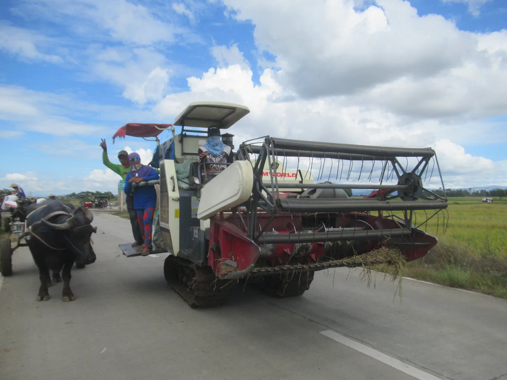

- **Shows:** Small rice combine harvester carrying several farmers between paddies, beside a buffalo cart.
- **Source:** CNEcija12345 — Wikimedia Commons — https://commons.wikimedia.org/wiki/File:Rice_combine_harvesterCNE_04.jpg
- **Context:** Nueva Ecija, Philippines (2025) — conceptual illustration of shared machinery.
- **Concerns:** Not Vietnamese (accepted as conceptual).
- **Usage:** CC BY-SA 4.0 — credit required.
- **File:** `server/media/clues/q03-02.webp` (1440×1080, 89 KB)

### q03-03 · clue 3 (20 s) · replaced
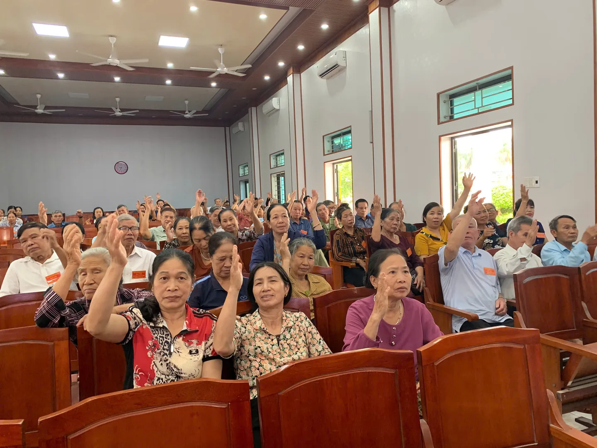

- **Shows:** Hall of ordinary rural members raising hands to vote at a cooperative members' congress.
- **Source:** Phạm Thị Xuân – Đài Truyền thanh xã Lê Lợi — Cổng thông tin điện tử xã Lê Lợi, tỉnh Hưng Yên — https://leloi.hungyen.gov.vn/dai-hoi-thanh-vien-hop-tac-xa-san-xuat-kinh-doanh-dich-vu-nong-nghiep-le-loi-nhiem-ky-2026-2031-than-c2372.html
- **Context:** Đại hội thành viên HTX SXKD DVNN Lê Lợi, nhiệm kỳ 2026–2031, 22/4/2026. Caption: "Đại biểu biểu quyết kết quả bầu cử."
- **Concerns:** Contemporary (2026), not historical; no banner or answer text in frame.
- **Usage:** Commune government site; local classroom use with credit.
- **File:** `server/media/clues/q03-03.webp` (1440×1080, 164 KB)

### q03-04 · clue 4 (30 s) · retained
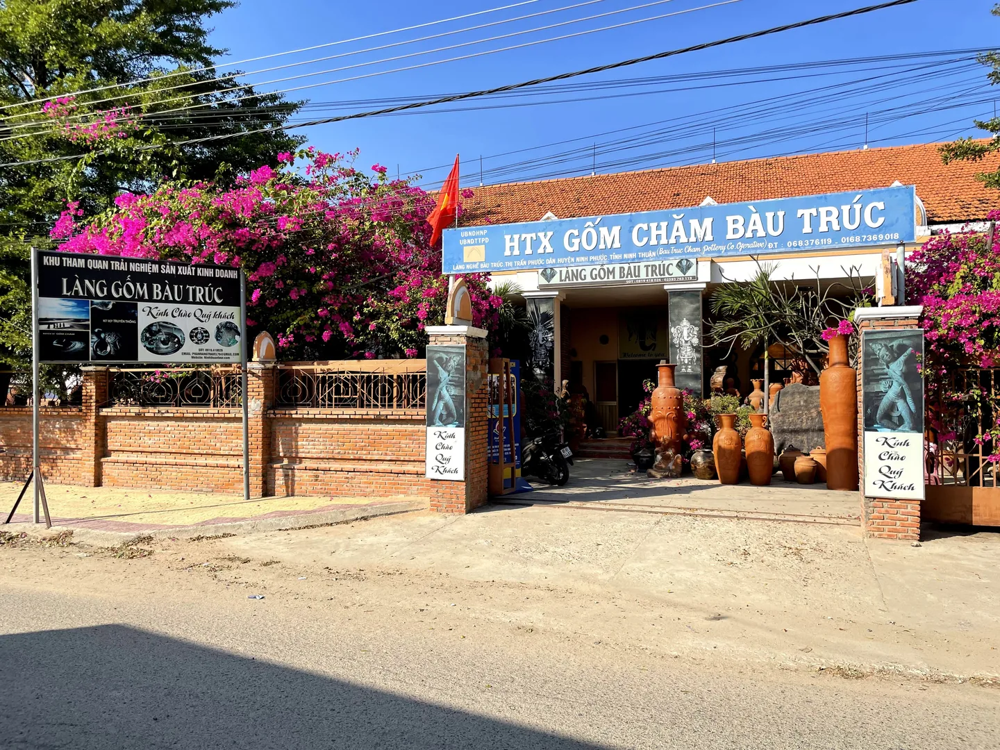

- **Shows:** Storefront of a real cooperative with a large sign "HTX GỐM CHĂM BÀU TRÚC".
- **Source:** Windrain — Wikimedia Commons — https://commons.wikimedia.org/wiki/File:H%E1%BB%A3p_t%C3%A1c_x%C3%A3_G%E1%BB%91m_Ch%C4%83m_B%C3%A0u_Tr%C3%BAc.jpg
- **Context:** Bàu Trúc Cham pottery cooperative, Ninh Thuận (handicraft, not agricultural).
- **Concerns:** "HTX" visible by design (clue 4); full words not on the sign.
- **Usage:** CC BY-SA 4.0 — credit required.
- **File:** `server/media/clues/q03-04.webp` (1440×1080, 450 KB)

## Q04 — ĐỔI MỚI

### q04-01 · clue 1 (0 s) · retained
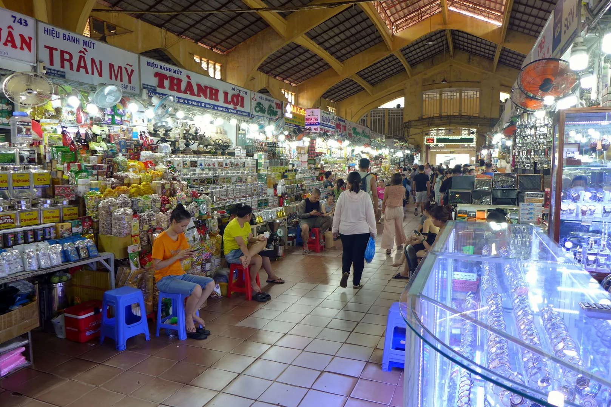

- **Shows:** Busy aisle in Bến Thành Market with private stalls packed with goods.
- **Source:** Bahnfrend — Wikimedia Commons — https://commons.wikimedia.org/wiki/File:Ben_Thanh_Market,_2023_(05).jpg
- **Context:** Ho Chi Minh City, 2023.
- **Concerns:** Fits several answers (intended for clue 1).
- **Usage:** CC BY-SA 4.0 — credit required.
- **File:** `server/media/clues/q04-01.webp` (1618×1080, 332 KB)

### q04-02 · clue 2 (10 s) · retained
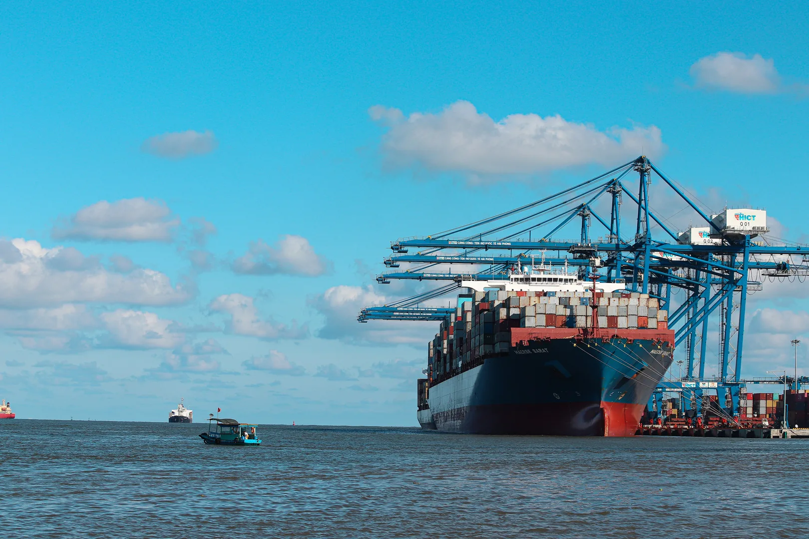

- **Shows:** Fully loaded container ship under cranes at Hải Phòng International Container Terminal.
- **Source:** Nathan.cima — Wikimedia Commons — https://commons.wikimedia.org/wiki/File:Container_Ship_at_the_Hai_Phong_International_Container_Terminal_01.jpg
- **Context:** Export-oriented trade, Hải Phòng, 2022.
- **Concerns:** Shows exports via port rather than a factory floor; visually similar to q05-01.
- **Usage:** CC BY-SA 4.0 — credit required.
- **File:** `server/media/clues/q04-02.webp` (1620×1080, 251 KB)

### q04-03 · clue 3 (20 s) · retained
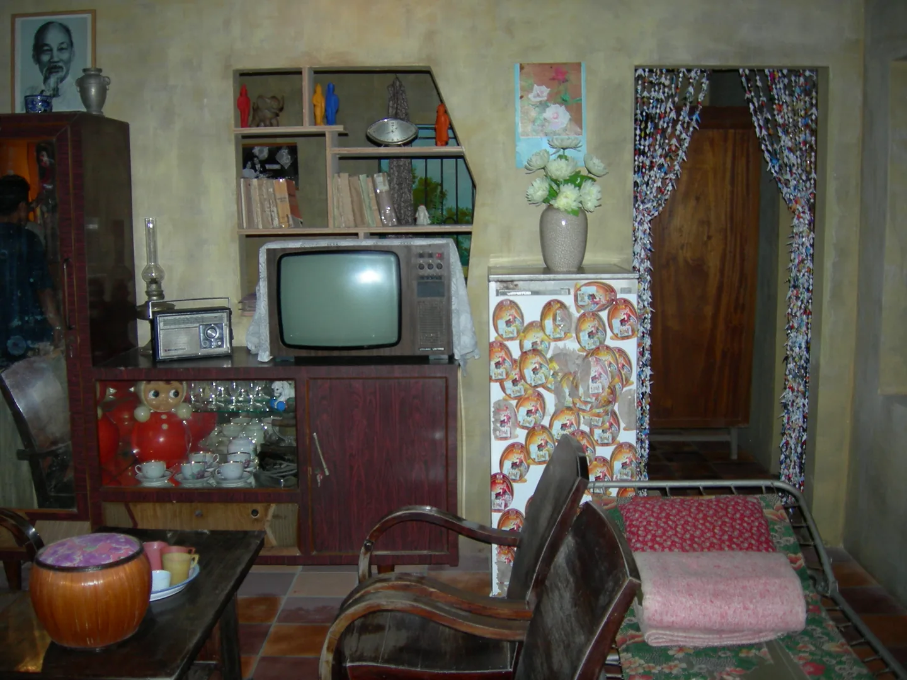

- **Shows:** Recreated subsidy-era living room: CRT TV, radio, Saratov fridge, folding bed, Hồ Chí Minh portrait.
- **Source:** Rungbachduong — Wikimedia Commons — https://commons.wikimedia.org/wiki/File:Thoi_bao_cap.jpg
- **Context:** Museum reconstruction at the Vietnam Museum of Ethnology (2006) — the "before 1986" side of the contrast.
- **Concerns:** Reconstruction, not a 1980s photo. Students may answer "BAO CẤP" (Q01) — a reasonable trap.
- **Usage:** CC BY-SA 3.0 — credit required.
- **File:** `server/media/clues/q04-03.webp` (1440×1080, 133 KB)

### q04-04 · clue 4 (30 s) · replaced
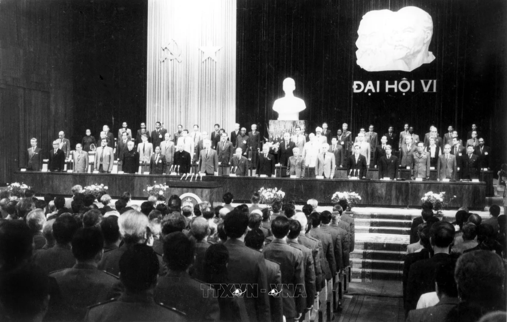

- **Shows:** Black-and-white wide shot of the congress hall: presidium standing on stage, delegates in the foreground, large "ĐẠI HỘI VI" lettering with Marx–Lenin relief and Hồ Chí Minh bust.
- **Source:** TTXVN (ảnh tư liệu) — TTXVN – Nhân vật & Sự kiện "Đại hội Đảng lần thứ VI (15-18/12/1986)" — https://nvsk.vnanet.vn/dai-hoi-dang-lan-thu-vi-15-18-12-1986-1-40398.vna
- **Context:** Đại hội đại biểu toàn quốc lần thứ VI, Hà Nội, 15–18/12/1986. Stage lettering "ĐẠI HỘI VI"; filed by TTXVN under that congress; same image in Báo Văn hóa.
- **Concerns:** Specific session/moment not stated. TTXVN-VNA watermark kept. No "ĐỔI MỚI" text.
- **Usage:** TTXVN copyright; local classroom use with credit.
- **File:** `server/media/clues/q04-04.webp` (1700×1080, 150 KB)

## Q05 — WTO

### q05-01 · clue 1 (0 s) · retained
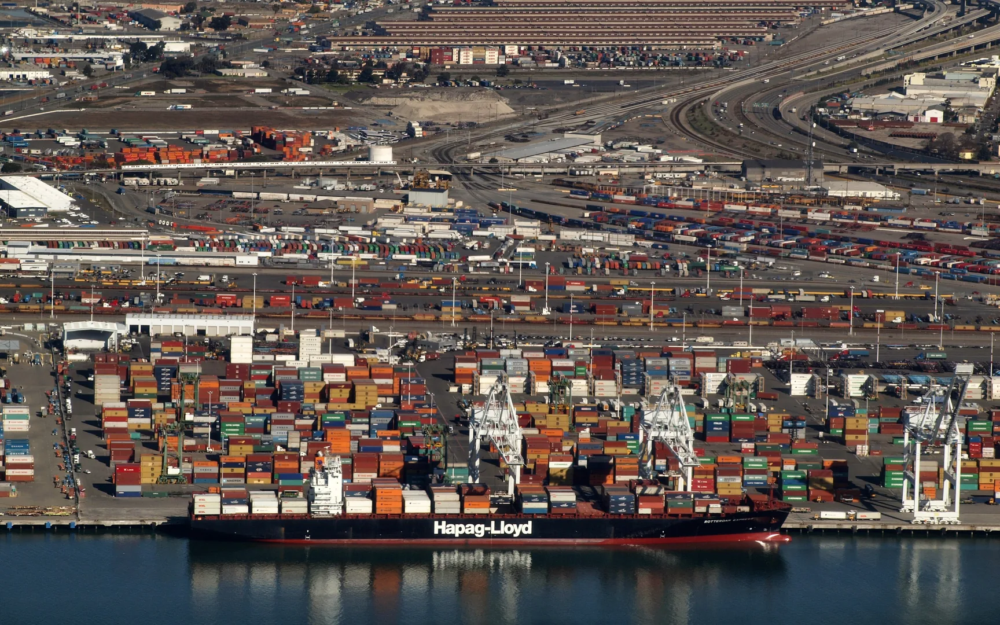

- **Shows:** Aerial view of a large container terminal with a container ship under gantry cranes.
- **Source:** Daniel Parks — Wikimedia Commons — https://commons.wikimedia.org/wiki/File:Port_of_Oakland.jpg
- **Context:** Port of Oakland, USA, 2010.
- **Concerns:** "Hapag-Lloyd" on the hull (not an answer leak).
- **Usage:** CC BY 2.0 — credit required.
- **File:** `server/media/clues/q05-01.webp` (1728×1080, 392 KB)

### q05-02 · clue 2 (10 s) · replaced
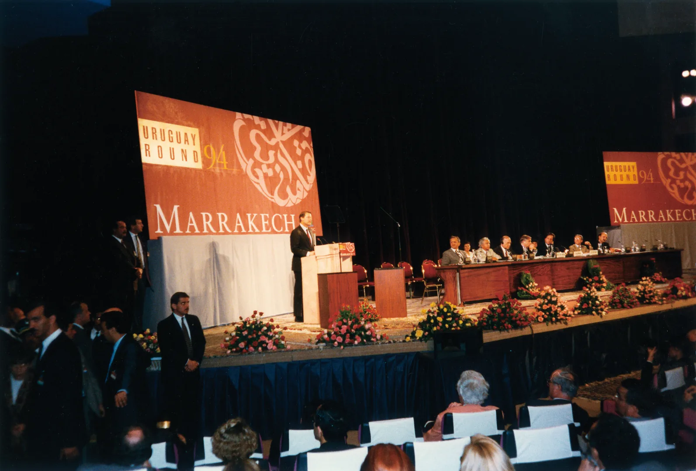

- **Shows:** Conference hall: speaker at a lectern, officials at a long head table, red banners "URUGUAY ROUND 94 – MARRAKECH".
- **Source:** © WTO — WTO Flickr, via Wikimedia Commons — https://commons.wikimedia.org/wiki/File:Marrakesh_Agreement_April_1994_(9308759604).jpg
- **Context:** Marrakech ministerial meeting, 12–15 April 1994, which concluded the GATT Uruguay Round and created the WTO.
- **Concerns:** No WTO text or emblem visible. Speaker not identified by the source — do not name him.
- **Usage:** CC BY-SA 2.0 — credit "© WTO" required.
- **File:** `server/media/clues/q05-02.webp` (1593×1080, 113 KB)

### q05-03 · clue 3 (20 s) · replaced
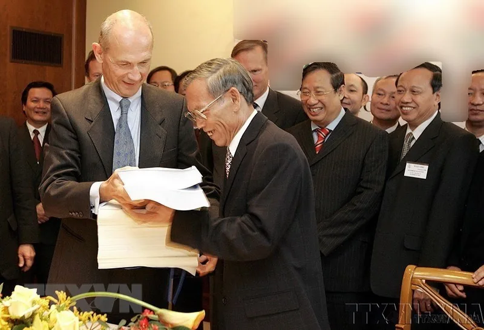

- **Shows:** WTO Director-General Pascal Lamy takes the thick accession protocol from Minister Trương Đình Tuyển; Vietnamese delegates smile behind them.
- **Source:** TTXVN — Tạp chí Công Thương "Chuyện đàm phán gia nhập WTO" — https://tapchicongthuong.vn/chuyen-dam-phan-gia-nhap-wto-117293.htm
- **Context:** Caption: "Ngày 7/11/2006, Bộ trưởng Bộ Thương mại Trương Đình Tuyển và Tổng Giám đốc WTO Pascal Lamy ký Nghị định thư về việc Việt Nam gia nhập WTO." This is the accession approval/signing in Geneva (7/11/2006), not the 11/1/2007 date Vietnam became the 150th member.
- **Concerns:** EDITED: the backdrop with three WTO globe emblems (= clue 4) was blurred; people, documents and both TTXVN watermarks untouched. Low resolution (800×546).
- **Usage:** TTXVN copyright; edited copy for local classroom use only.
- **File:** `server/media/clues/q05-03.webp` (800×546, 52 KB)

### q05-04 · clue 4 (30 s) · retained

- **Shows:** WTO emblem: six curved red, blue and green stripes forming a globe, no lettering.
- **Source:** World Trade Organization — Wikimedia Commons — https://commons.wikimedia.org/wiki/File:World_Trade_Organization_(logo_globe_only).svg
- **Context:** Official WTO emblem (c. 1995).
- **Concerns:** Unaltered; rendered on white with a margin.
- **Usage:** Public domain (too simple for copyright) but a registered trademark — fine for non-commercial classroom use.
- **File:** `server/media/clues/q05-04.webp` (1132×1080, 22 KB)

## Q06 — PHÁT TRIỂN BỀN VỮNG

### q06-01 · clue 1 (0 s) · retained
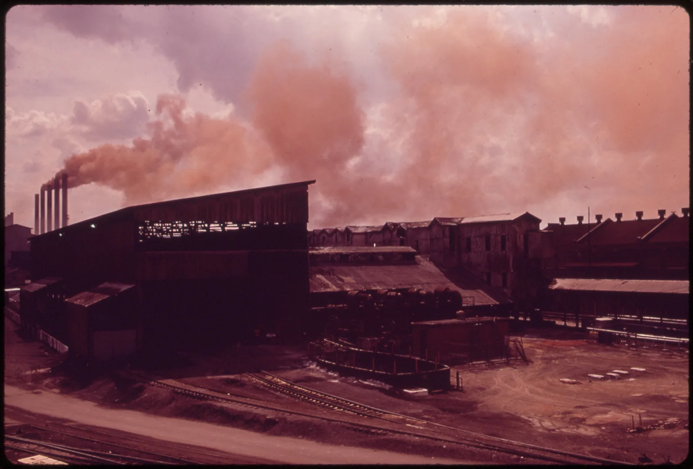

- **Shows:** Steel works with thick red-orange smoke over the sheds and rail tracks (1970s colour slide).
- **Source:** LeRoy Woodson / US EPA DOCUMERICA — Wikimedia Commons — https://commons.wikimedia.org/wiki/File:U.S._STEEL_PLANT_EMITS_RED-ORANGE_SMOKE_24_HOURS_A_DAY_-_NARA_-_545445.jpg
- **Context:** Birmingham, Alabama, May 1972.
- **Concerns:** Warm colour cast of the original slide.
- **Usage:** Public domain (US government).
- **File:** `server/media/clues/q06-01.webp` (1595×1080, 79 KB)

### q06-02 · clue 2 (10 s) · retained
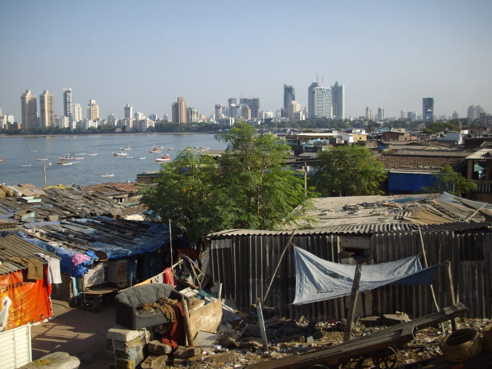

- **Shows:** Tin-roofed shacks in the foreground; across a bay, a skyline of high-rises.
- **Source:** Rudolph A. Furtado — Wikimedia Commons — https://commons.wikimedia.org/wiki/File:%27vaibhav_Apts%27_locality_seen_from_Worli_Fort.JPG
- **Context:** Worli, Mumbai, 2007.
- **Concerns:** Not Vietnamese; theme is universal.
- **Usage:** Public domain (released by author).
- **File:** `server/media/clues/q06-02.webp` (1440×1080, 183 KB)

### q06-03 · clue 3 (20 s) · retained
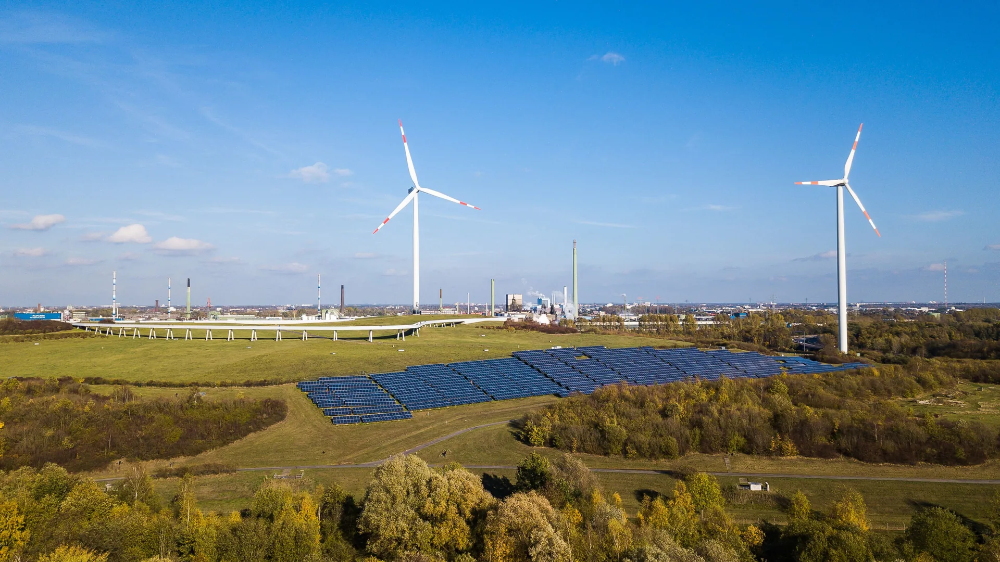

- **Shows:** Aerial view of wind turbines and a solar array on a grassed hill with woodland in front.
- **Source:** Sebastian Koppehel — Wikimedia Commons — https://commons.wikimedia.org/wiki/File:Energieberg_Georgswerder_01.jpg
- **Context:** Energieberg Georgswerder, Hamburg: a former landfill turned renewable-energy site (2018).
- **Concerns:** —
- **Usage:** CC BY 4.0 — credit required.
- **File:** `server/media/clues/q06-03.webp` (1920×1080, 314 KB)

### q06-04 · clue 4 (30 s) · retained
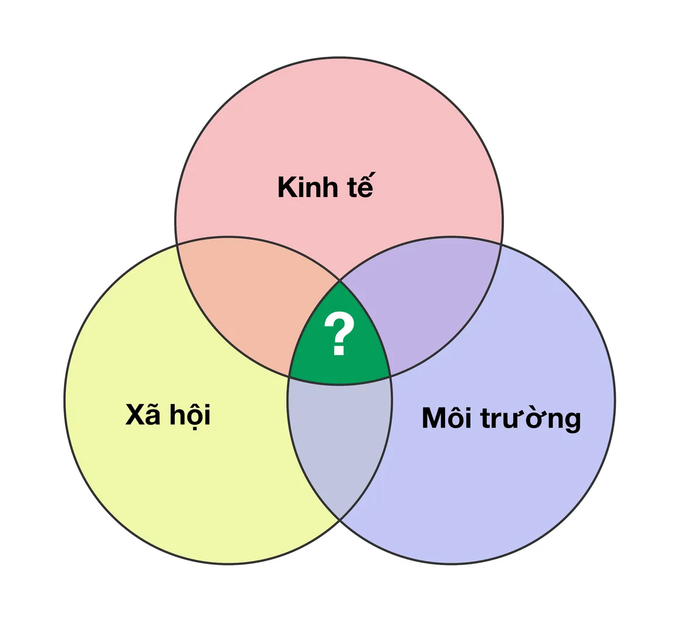

- **Shows:** Three overlapping circles labelled Kinh tế, Xã hội, Môi trường with a white "?" in the green centre.
- **Source:** Nicoguaro (modified) — Wikimedia Commons — https://commons.wikimedia.org/wiki/File:Sustainability_venn_diagram.svg
- **Context:** Three-pillar model of sustainable development.
- **Concerns:** EDITED: "Sustainability" label and arrow removed, labels translated, "?" added. Source SVG in docs/clue-sources/.
- **Usage:** CC BY 4.0 — credit and note of changes required.
- **File:** `server/media/clues/q06-04.webp` (1185×1080, 27 KB)
